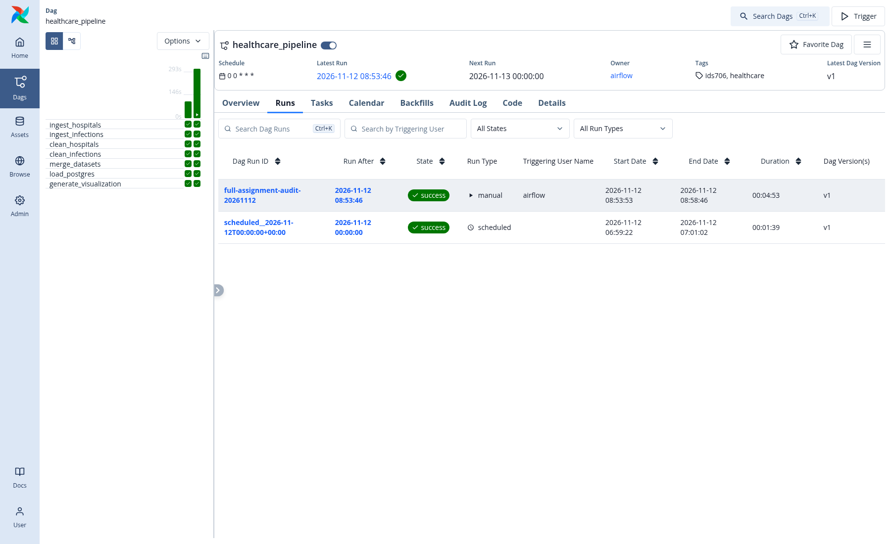
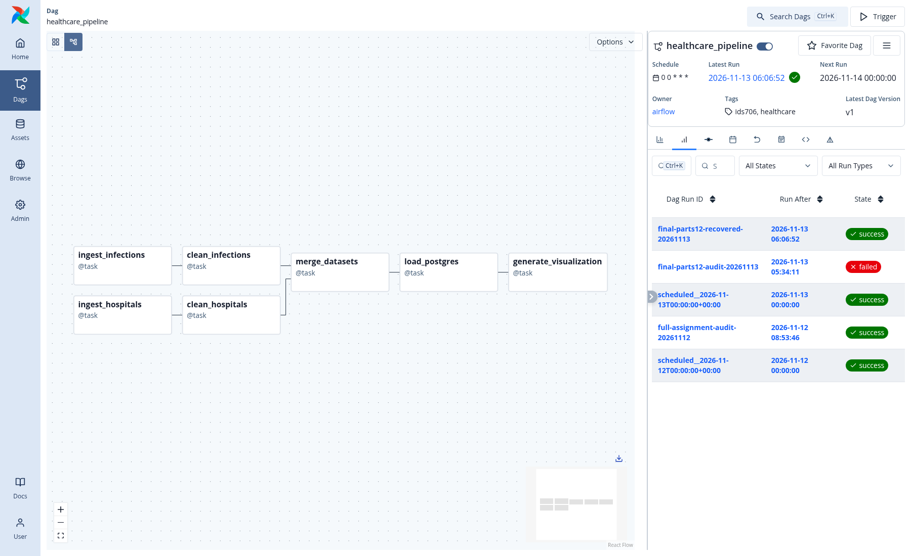
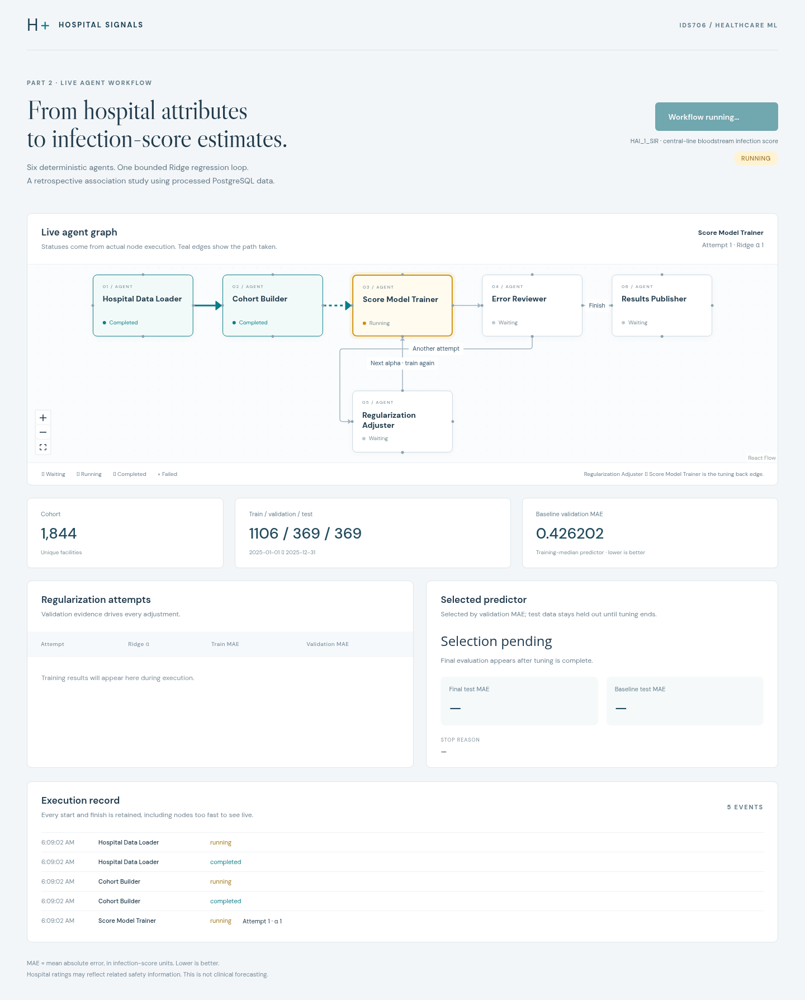
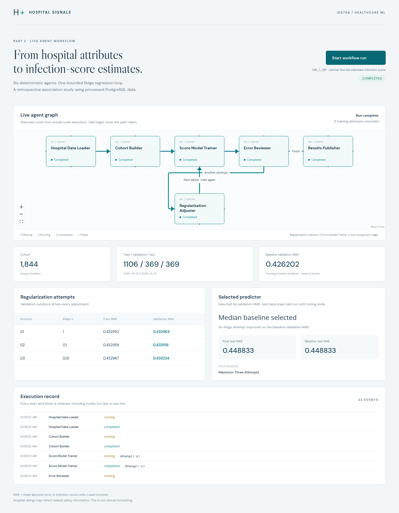
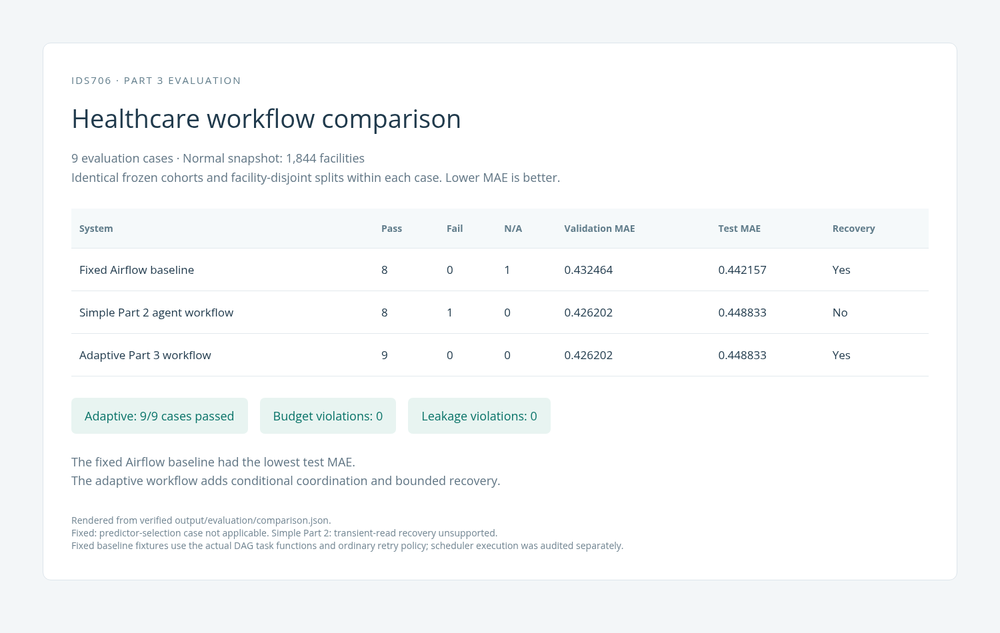

# IDS 706 Mini Assignment: Data Orchestration with Apache Airflow

## Project Description
This project aims to build an end-to-end healthcare data pipeline using Apache Airflow and use the cleaned data in an agent-based machine learning workflow. The project focuses on practicing data ingestion, transformation, task orchestration, workflow automation, and agent coordination.

## Project Structure

```text
IDS706-Mini-Assignment-Apache-Airflow-Orchestration/
├── dags/                     # Airflow DAGs for ETL and the fixed ML baseline
├── dataset/                  # CMS healthcare source datasets
├── ml_workflow/              # Part 2 LangGraph ML workflow and backend logic
├── frontend/                 # Live UI for visualizing Part 2 agent execution
├── adaptive_workflow/        # Part 3 adaptive multi-agent workflow and routing
├── evaluation/               # Evaluation cases and three-system comparison
├── tests/                    # Unit, integration, and workflow validation tests
├── audit/                    # Runtime and assignment-requirement verification
├── screenshots/              # Screenshots used as submission evidence
├── output/                   # Generated metrics, plots, predictions, and results
├── images/                   # Images used in the README and documentation
├── Dockerfile                # Base Docker image configuration
├── docker-compose.yaml       # Core Airflow and PostgreSQL services
├── compose.ml.yaml           # Part 2 ML workflow and UI services
├── compose.part3.yaml        # Part 3 adaptive workflow services
├── compose.evaluation.yaml   # Evaluation and comparison services
└── README.md                 # Project overview, architecture, and instructions
```

## Overall Setup Instructions
### 1. Create GitHub repository
General:
- Name the repository with `IDS706-Mini-Assignment-Apache-Airflow-Orchestration`.

Configuration:
- Add README - Toggle On option.
- Add .gitignore - Select Python.
- Proceed to create repository.

### 2. Clone repository in VS Code
- Open Command Palette and select `Git: Clone`.
- Paste GitHub repository URL (e.g. https://github.com/violathadtanone/IDS706-Mini-Assignment-Apache-Airflow-Orchestration).
- Select the local folder to continue the development.

### 3. Set up a Python virtual environment
- Create and activate the virtual environment on Terminal with the code below:
```bash
python -m venv .venv
source .venv/bin/activate
```
- Upgrade pip to ensure that it is compatible with the current Python version before installing other packages.
```bash
python -m pip install --upgrade pip
```
### 4. Set up the containerized development environment
- Make sure Docker Desktop is installed and running.

- Build the required Docker services:

```bash
docker compose -f docker-compose.yaml -f compose.part3.yaml -f compose.ml.yaml -f compose.evaluation.yaml build
```

- Start the Airflow and PostgreSQL services:

```bash
docker compose -f docker-compose.yaml -f compose.part3.yaml up -d postgres healthcare-db airflow-init airflow-api-server airflow-scheduler airflow-dag-processor
```

- Start the Part 2 machine learning workflow and live agent interface:

```bash
docker compose -f docker-compose.yaml -f compose.part3.yaml -f compose.ml.yaml up -d healthcare-ml
```

- Confirm that the containers are running:

```bash
docker compose ps
```

Useful local interfaces:

| Service | URL |
|---|---|
| Airflow UI | http://localhost:8080 |
| Part 2 Agent UI | http://localhost:8001 |

### 5. Run the Airflow workflow
**Goal:** Run the end-to-end healthcare data pipeline from ingestion through analysis.

- Make sure the Airflow and PostgreSQL services are running:

```bash
docker compose -f docker-compose.yaml -f compose.part3.yaml up -d postgres healthcare-db airflow-init airflow-api-server airflow-scheduler airflow-dag-processor
```

- Confirm that the services are running:

```bash
docker compose -f docker-compose.yaml -f compose.part3.yaml ps
```

- Open the local Airflow UI:

http://localhost:8080

- The Airflow username is:

```text
student
```

- Retrieve the automatically generated password:

```bash
docker compose exec airflow-api-server cat /opt/airflow/simple_auth_manager_passwords.json.generated
```

- Log in, open **DAGs**, and locate the healthcare pipeline DAG.

- Trigger the DAG manually if needed, then use the **Graph** view to monitor each task.

### 6. Run the Part 2 agent-based machine learning workflow
**Goal:** Run the agent-based machine learning workflow using the cleaned healthcare data from Part 1.

- Make sure the Part 1 Airflow pipeline has completed and PostgreSQL is running.

- Start the Part 2 service:

```bash
docker compose -f docker-compose.yaml -f compose.part3.yaml -f compose.ml.yaml up -d healthcare-ml
```

- Confirm that the service is running:

```bash
docker compose -f docker-compose.yaml -f compose.part3.yaml -f compose.ml.yaml ps healthcare-ml
```

- Open the live agent interface:

http://localhost:8001

- Select **Start workflow run** to execute the workflow and observe the live agent graph, model-adjustment loop, and final MAE results.
<br><br>

## Dataset Description
This project uses two datasets from the Centers for Medicare & Medicaid Services (CMS):
- [Hospital General Information](https://data.cms.gov/provider-data/dataset/xubh-q36u) — This contains general information about hospitals, including facility identifiers, hospital type, location, ownership, and overall hospital ratings.
- [Healthcare Associated Infections—Hospital](https://data.cms.gov/provider-data/dataset/77hc-ibv8) — This contains hospital-level measures related to healthcare-associated infections, including infection measure types, reported scores, and reporting periods.
- These two datasets can be linked using the shared Facility ID, allowing hospital characteristics to be combined with infection-related outcomes for analysis.
<br><br>

## Overall Architecture


The project is organized into three stages:

- **Part 1:** Prepare, transform, and store healthcare data using Apache Airflow.
- **Part 2:** Use the cleaned data in an agent-based machine learning workflow.
- **Part 3:** Extend the workflow with adaptive routing, specialist agents, and failure recovery.

### Part 1 — Airflow Pipeline
- Two related CMS healthcare datasets are ingested and cleaned independently, then merged using `Facility ID`.
- The merged data is stored in PostgreSQL and read back for analysis.
- Independent ingestion and cleaning tasks run in parallel before the merge.
- Cleaning includes missing-value handling, numeric and date conversion, and validation of facility and infection-record keys.
- The DAG runs daily at **00:00 UTC**.
- The analysis summarizes average `HAI_1_SIR` infection scores by hospital rating and generates a visualization.

### Part 2 — Agent-Based ML Workflow
- The cleaned Part 1 data is used in an agent-based machine learning workflow.
- Six agents handle data loading, cohort preparation, model training, error review, regularization adjustment, and result publication.
- The workflow can loop through multiple Ridge regression attempts based on validation performance.
- A live graph displays the actual agent execution and loop transitions.
- The model estimates `HAI_1_SIR` using hospital rating, hospital type, and state, with MAE used for evaluation.

### Part 3 — Adaptive Multi-Agent Workflow
- Part 3 extends the agent workflow with specialist agents and a dispatcher that selects the next action based on intermediate results.
- The workflow can dynamically route between model specialists, reporting, and recovery steps.
- Temporary failures can be retried through a Recovery Coordinator, while permanent data or schema errors stop safely.
- The adaptive workflow is compared with a fixed Airflow baseline and the simpler Part 2 agent workflow.

<br><br>

## DAG Execution Results

### Airflow DAG Execution



The Airflow pipeline successfully completed the healthcare workflow from ingestion through analysis. The two datasets were cleaned independently before being merged, loaded into PostgreSQL, and used for downstream analysis.

### Airflow DAG Graph



The DAG graph shows the parallel ingestion and cleaning branches. Both branches join at the merge step before the data is loaded into PostgreSQL and used to generate the final visualization.

### Agent Workflow



The Part 2 live agent graph shows the modified healthcare workflow. Agents coordinate data loading, cohort preparation, model training, error review, regularization adjustment, and result publication. The back edge represents the model-adjustment loop.

### Model Evaluation Results



The workflow evaluated multiple Ridge regression configurations using validation MAE. None improved on the median baseline, so the median predictor was selected. The final validation MAE was **0.426202** and the test MAE was **0.448833**.

### Part 3 Evaluation



The adaptive workflow passed all **nine evaluation cases**. The fixed Airflow baseline achieved the lowest test MAE, while the adaptive workflow added conditional routing and recovery from eligible temporary failures.

### Key Findings

- The Airflow pipeline successfully processed and merged the two healthcare datasets using parallel task execution.
- The median baseline outperformed the tested Ridge configurations on validation MAE.
- The adaptive Part 3 workflow did not improve test MAE over the fixed baseline, but it provided stronger routing, coordination, and failure-recovery behavior.
- All nine Part 3 evaluation cases passed, with no observed split-leakage, test-isolation, or execution-budget violations.

## Baseline Comparison

Part 3 was compared against healthcare adaptations of the **two baseline workflow patterns demonstrated in class**:

| Workflow | Classroom baseline it represents | Key behavior |
|---|---|---|
| **Fixed Airflow Baseline** | Fixed Airflow workflow | Executes predefined steps with one fixed Ridge model and no adaptive model selection. |
| **Part 2 Agent Workflow** | Simple agentic workflow | Uses agents and a bounded model-adjustment loop, but has limited routing and no database-recovery agent. |
| **Part 3 Adaptive Workflow** | Proposed adaptive system | Dynamically selects specialist agents based on intermediate results and can route recoverable failures through a Recovery Coordinator. |

All three healthcare workflows use the same prediction task, cohort, train/validation/test splits, predictors, and MAE metric so their results can be compared fairly.

| Healthcare Workflow | Validation MAE | Test MAE | Failure Recovery |
|---|---:|---:|---|
| Fixed Airflow Baseline | 0.432464 | **0.442157** | Standard task retry |
| Part 2 Agent Workflow | **0.426202** | 0.448833 | No |
| Part 3 Adaptive Workflow | **0.426202** | 0.448833 | Adaptive recovery agent |

The fixed Airflow workflow achieved the lowest test MAE, while the Part 3 workflow provided the strongest coordination and recovery behavior. The adaptive workflow passed all nine evaluation cases, including routing, recovery, invalid-input handling, test-set isolation, and execution-budget checks.