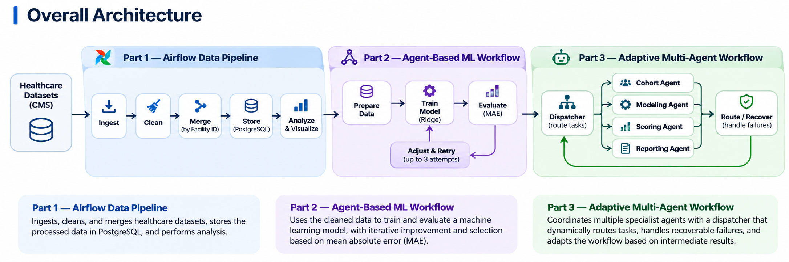

# IDS 706 Mini Assignment: Data Orchestration with Apache Airflow

## Project Description
This project aims to build an end-to-end healthcare data pipeline using Apache Airflow and use the cleaned data in an agent-based machine learning workflow. The project focuses on practicing data ingestion, transformation, task orchestration, workflow automation, and agent coordination.

## Project Structure

```text
IDS706-Mini-Assignment-Apache-Airflow-Orchestration/
├── dags/                     # Airflow DAGs for ETL and the fixed ML baseline
├── dataset/                  # CMS healthcare source datasets
├── ml_workflow/              # Part 2 LangGraph ML workflow and backend logic
├── frontend/                 # Live UI for visualizing Part 2 agent execution
├── adaptive_workflow/        # Part 3 adaptive multi-agent workflow and routing
├── evaluation/               # Evaluation cases and three-system comparison
├── tests/                    # Unit, integration, and workflow validation tests
├── audit/                    # Runtime and assignment-requirement verification
├── screenshots/              # Screenshots used as submission evidence
├── output/                   # Generated metrics, plots, predictions, and results
├── images/                   # Images used in the README and documentation
├── Dockerfile                # Base Docker image configuration
├── docker-compose.yaml       # Core Airflow and PostgreSQL services
├── compose.ml.yaml           # Part 2 ML workflow and UI services
├── compose.part3.yaml        # Part 3 adaptive workflow services
├── compose.evaluation.yaml   # Evaluation and comparison services
└── README.md                 # Project overview, architecture, and instructions
```

### Overall Architecture


This project uses two datasets from the Centers for Medicare & Medicaid Services (CMS):
- [Hospital General Information](https://data.cms.gov/provider-data/dataset/xubh-q36u) — This contains general information about hospitals, including facility identifiers, hospital type, location, ownership, and overall hospital ratings.
- [Healthcare Associated Infections—Hospital](https://data.cms.gov/provider-data/dataset/77hc-ibv8) — This contains hospital-level measures related to healthcare-associated infections, including infection measure types, reported scores, and reporting periods.
- These two datasets can be linked using the shared Facility ID, allowing hospital characteristics to be combined with infection-related outcomes for analysis.
<br><br>

### Overall Architecture

The project is organized into three stages:
- Part 1 - Prepare and store the healthcare data using Apache Airflow
- Part 2 - Use the cleaned data in an agent-based machine learning workflow
- Part 3 - extends the workflow with adaptive routing and recovery

### Part 1 — Airflow Pipeline
- This step builds an end-to-end data pipeline using Apache Airflow. Two related healthcare datasets are ingested and cleaned independently, then merged using Facility ID.
- The merged data is stored in PostgreSQL and read back for analysis. Independent tasks run in parallel where appropriate, and the pipeline is executed on a scheduled DAG.

### Part 2 — Agent-Based ML Workflow
- This part uses the cleaned data from Part 1 in an agent-based machine learning workflow.
- Different agents handle data preparation, model training, evaluation, and model adjustment. The workflow can loop through multiple model attempts and uses mean absolute error (MAE) to select the best validated predictor.
- A live graph interface shows the actual agent execution and loop transitions.

### Part 3 — Adaptive Multi-Agent Workflow
- This part extends the workflow by introducing multiple specialist agents with different responsibilities.
- A dispatcher selects the next agent based on intermediate results. The system can route tasks dynamically, retry temporary failures through a recovery agent, and stop appropriately when a permanent error occurs.
- This adaptive workflow is later compared against a fixed Airflow workflow and the simpler agent-based workflow from Part 2.
<br><br>

### Evaluation Suite

The evaluation suite measures both model performance and agent coordination. Each test case defines an input or fault condition, expected behavior, scoring criteria, and a pass/fail threshold.

The tests cover normal execution, model selection, invalid inputs, failure recovery, test-set isolation, and execution limits. All nine evaluation cases passed for the adaptive workflow.

### Baseline Comparison

The adaptive system is compared against two healthcare versions of the workflows demonstrated in class:

- **Fixed Airflow baseline:** follows predefined execution steps with no adaptive model selection.
- **Simple agentic baseline:** uses the Part 2 LangGraph workflow with a bounded model-adjustment loop.
- **Adaptive Part 3 workflow:** dynamically selects specialist agents and can recover from eligible transient failures.

| System | Validation MAE | Test MAE | Recovery |
|---|---:|---:|---|
| Fixed Airflow baseline | 0.432464 | 0.442157 | Yes |
| Part 2 agent workflow | 0.426202 | 0.448833 | No |
| Part 3 adaptive workflow | 0.426202 | 0.448833 | Yes |

The fixed Airflow baseline achieved the lowest test MAE, while the adaptive workflow provided stronger routing and recovery capabilities.
